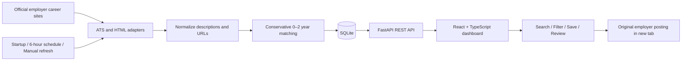
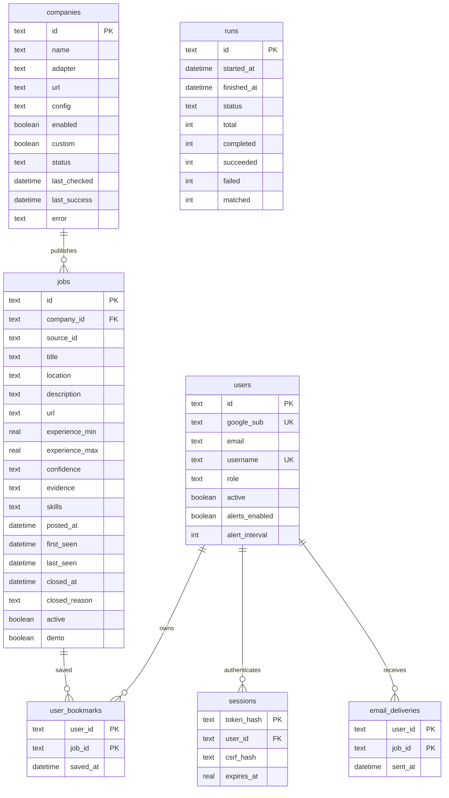

# System workflow and architecture

## Collection lifecycle

1. Initialize SQLite and upsert the company registry while preserving enabled settings. Mark an interrupted previous run for review.
2. A single process owns the refresh service. Startup, the scheduler, and API requests all use that service. If a run is already active, another refresh returns its existing ID.
3. Create a refresh history record and load enabled company configurations.
4. Process up to four companies concurrently. A shared semaphore caps outgoing requests at six. Requests have connection/read timeouts, a small pacing delay, and up to three attempts for transient errors; HTTP 429 respects a bounded Retry-After delay.
5. Read public feed pages. Fetch descriptions for relevant software titles, then normalize and classify each posting.
6. Commit one company snapshot atomically. Deduplicate by `(company_id, source_id)`. Preserve first-seen time and bookmarks; update last-seen time and current job fields.
7. Only a complete successful authoritative snapshot retires unseen live jobs. Partial snapshots merge without retirement. Failed snapshots record an error without mutating jobs.
8. Update refresh progress and source status. React polls progress every 2.5 seconds during collection and status every 15 seconds otherwise.
9. After all companies finish, store completion time and success/failure counts. Graceful shutdown cancels in-flight collection and marks the run interrupted.

## Backend modules

| Module | Responsibility |
| --- | --- |
| `companies.py` | Editable registry of 100 company sources and ATS configurations |
| `collectors.py` | Public feed pagination, details, HTML/JSON-LD parsing, URL normalization |
| `amazon.py`, `eightfold.py`, `goldman.py`, `google_careers.py` | Employer-specific public search feeds and embedded data, full qualifications, scoped/partial coverage |
| `robots.py` | Most-specific robots path rules, Allow ties, wildcards, and terminal anchors |
| `sources.py` | Public careers URL validation, ATS discovery, and safe parsing of embedded Atlassian board data |
| `matching.py` | Software-title detection, conservative numeric experience filtering, match evidence, skills |
| `db.py` | SQLite schema, atomic snapshots, source state, job serialization |
| `service.py` | Scheduled/manual refresh lifecycle, concurrency, source errors, history |
| `main.py` | FastAPI endpoints, request validation, API authentication middleware, static frontend serving |
| `demo.py` | Explicit sample fixtures isolated from live results |
| `refresh.py` | One-off collection CLI, used when the server is stopped |

## SQLite model

SQLite uses foreign keys, WAL journaling, a 30-second busy timeout, and explicit transactions. Job IDs are stable SHA-256-derived identifiers, and queries use bound parameters. Descriptions are rendered as plain text by React. Collected application links must use HTTPS. No application forms are submitted by the tool.

## API

| Method | Endpoint | Purpose |
| --- | --- | --- |
| GET | `/api/health` | Database/server health |
| GET | `/api/jobs` | Search, filter, sort, paginated jobs; live/demo scopes |
| GET | `/api/jobs/{id}` | Job details and saved state |
| POST | `/api/companies` | Save a custom company, detect its source, and queue collection |
| GET | `/api/companies` | Company source state and active live match count |
| PATCH | `/api/companies/{id}` | Enable or pause collection |
| PUT | `/api/bookmarks/{id}` | Idempotently save a job |
| DELETE | `/api/bookmarks/{id}` | Remove a bookmark |
| GET | `/api/stats` | Dashboard counts and latest refresh progress |
| POST | `/api/refresh` | Queue refresh; optional company ID |
| GET | `/api/runs` | Last 20 collection runs |

`/api/jobs` accepts `q`, `location`, comma-separated `company` IDs, `confidence`, `mode`, `saved`, `demo`, `status` (open/closed/all), `sort`, `page`, and `page_size` (maximum 100). Interactive OpenAPI endpoints are disabled. All data APIs require a valid active-account session; mutations additionally require the session CSRF token.

## Frontend

Google sign-up/sign-in and master login gate the workspace. Discover jobs, Saved jobs, Companies, and My account & emails share one navigation shell. The master also sees Source activity and Manage accounts. Search input is debounced and stale requests are aborted. Filters reset pagination. A details drawer shows the original description, match evidence, source freshness, and application link. Saved states are persisted through the API. Keyboard users can open controls, dismiss dialogs with Escape, and tab within dialogs. Mobile screens have collapsible navigation and filters.

## Operating limits

This is a single-host, single-worker application with multiple authenticated users. It does not guarantee all employer vacancies are publicly accessible, and experience matching is heuristic. HTML sources, Oracle keyword searches, Amazon/Goldman search, location/keyword-filtered Eightfold results, and Google's permitted first results page are explicitly partial; Workday feeds reaching their 2,000-result ceiling are also partial. A new ATS format requires an adapter or registry correction. No JavaScript browser crawler or account-based collection is included. Demo mode is explicit and does not populate live results or source-health metrics.

## Custom sources and job retirement

`POST /api/companies` accepts `{name, url, sector, refresh}` and stores a custom registry row. Known ATS URLs are detected directly; general URLs are inspected in the worker for recruiting feeds and openings links. The resolved adapter and configuration are saved for subsequent runs, while the original employer careers URL is retained. A queue waits for an ongoing run and collects newly added companies afterward. Additive SQLite migrations preserve existing jobs, bookmarks, and company settings.

Full-feed adapters return the IDs of all source postings as well as eligible matches. This lets retirement distinguish a posting removed from the board (`removed`) from a posting whose current requirements no longer match (`no_longer_matches`). Both leave the active results, while saved copies remain accessible with a timestamp. Partial/failed reads do not infer removal. When the same job returns, its original bookmark and first-seen time are preserved and the archive fields are cleared.

The HTTP collector accepts public HTTPS URLs, validates DNS addresses, checks redirects before following them, and rejects local/private destinations. HTML sources, employer-specific search adapters, and discovery respect robots.txt, including explicit path exceptions and pagination restrictions. Embedded scripts are parsed as JSON data; their JavaScript is never executed.

## Authentication and authorization

`auth.py` protects every `/api/` path by default, except an explicit public allowlist for health, auth configuration, Google flow endpoints, and master login. Google authorization uses state bound to an HTTP-only browser cookie and a one-use database transaction, PKCE S256, and an OIDC nonce. Google's library verifies ID-token signatures, expiry, issuer, and audience; the app also requires a verified email and matching nonce. Google tokens are discarded after establishing identity. Google subject ID is the identity key; matching a master's email never grants privileges.

Sessions use random opaque tokens stored as SHA-256 hashes in SQLite, with seven-day expiry. Session cookies are HTTP-only, SameSite=Lax, host-only, and Secure on HTTPS. Each mutation requires a separate CSRF token tied to its server-side session and rejects foreign origins. Master passwords use salted scrypt hashes. Login/credential-change attempts are rate-limited in SQLite. Logout, account disablement, and master credential rotation revoke sessions server-side. Responses never include password hashes, Google IDs, OAuth tokens, or session secrets. OAuth callback access logs are disabled in deployment.

Public employer jobs are shared. `user_bookmarks` has a composite `(user_id, job_id)` key; every bookmark query, count, save, and delete scopes ownership to the current session. Alert settings update only the current session's user. Company modifications, manual refreshes, refresh history, user lists, and user status changes require the master role. The account list returns profile/status and aggregate counts, with no credentials. The original `bookmarks` table is retained only to preserve older installations; first master creation copies those saves to its private shortlist.

Additional endpoints:

| Method | Path | Access |
| --- | --- | --- |
| GET | `/api/auth/config` | Public setup status only |
| GET | `/api/auth/google` and `/api/auth/google/callback` | Public Google flow |
| POST | `/api/auth/master/login` | Public, rate-limited master login |
| GET | `/api/auth/me` | Own profile |
| POST | `/api/auth/logout` | Revoke own session |
| PUT | `/api/auth/master/credentials` | Master, current-password verification |
| PUT | `/api/account/alerts` | Own alert preferences |
| GET | `/api/account/email-status` | Own email status |
| GET | `/api/admin/users` | Master account directory |
| PATCH | `/api/admin/users/{id}` | Master enable/disable access |

## Email and deployment

`notifications.py` runs a minute-level scheduler beside collection. It waits until a collection finishes, selects opted-in active accounts due for delivery, and sends individual TLS-authenticated Gmail digests off the event loop. Google accounts begin with six-hourly alerts enabled; the sign-in screen discloses this. The master starts with alerts disabled. Only active, non-demo jobs first seen after account creation and matching the recipient's filters are eligible. Deliveries are recorded per user/job only after SMTP success, and failures back off for 15 minutes. A crash between Gmail acceptance and the SQLite commit can result in a repeated email; SMTP offers no transaction with SQLite.

The selected EC2 deployment pulls source from GitHub and reads a manually created, git-ignored `.env`. A systemd service runs one Uvicorn worker as a dedicated non-root user, with the capability to bind TCP 443 and validated exported ACM certificate files. `/var/lib/launchpad` holds persistent SQLite state and pre-update backups. Certificate exports are installed with restricted permissions and a verified key/certificate match. One worker owns all schedules; do not horizontally scale this deployment. `python -m app.backup DESTINATION` uses SQLite's online backup API. See [native EC2 deployment](ec2-native-deployment.md) and [credential setup](ec2-deployment.md).
