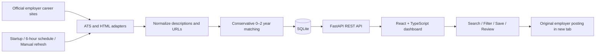
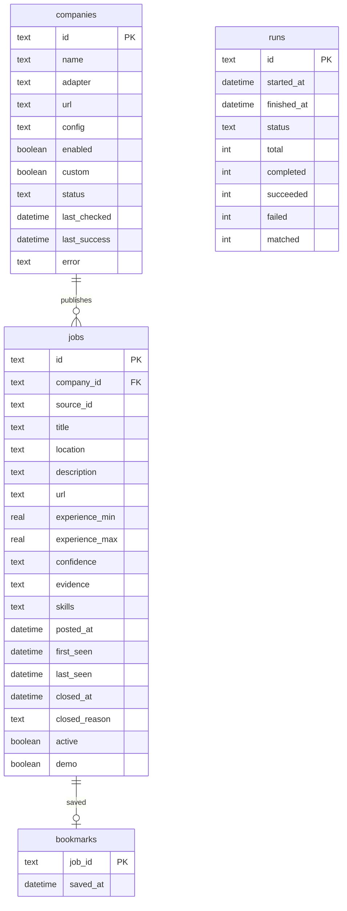

# System workflow and architecture

## Collection lifecycle

1. Initialize SQLite and upsert the company registry while preserving enabled settings. Mark an interrupted previous run for review.
2. A single process owns the refresh service. Startup, the scheduler, and API requests all use that service. If a run is already active, another refresh returns its existing ID.
3. Create a refresh history record and load enabled company configurations.
4. Process up to four companies concurrently. A shared semaphore caps outgoing requests at six. Requests have connection/read timeouts, a small pacing delay, and up to three attempts for transient errors; HTTP 429 respects a bounded Retry-After delay.
5. Read public feed pages. Fetch descriptions for relevant software titles, then normalize and classify each posting.
6. Commit one company snapshot atomically. Deduplicate by `(company_id, source_id)`. Preserve first-seen time and bookmarks; update last-seen time and current job fields.
7. Only a complete successful authoritative snapshot retires unseen live jobs. Partial snapshots merge without retirement. Failed snapshots record an error without mutating jobs.
8. Update refresh progress and source status. React polls progress every 2.5 seconds during collection and status every 15 seconds otherwise.
9. After all companies finish, store completion time and success/failure counts. Graceful shutdown cancels in-flight collection and marks the run interrupted.

## Backend modules

| Module | Responsibility |
| --- | --- |
| `companies.py` | Editable registry of 88 company sources and ATS configurations |
| `collectors.py` | Public feed pagination, details, HTML/JSON-LD parsing, URL normalization |
| `sources.py` | Public careers URL validation, ATS discovery, and safe parsing of embedded Atlassian board data |
| `matching.py` | Software-title detection, conservative numeric experience filtering, match evidence, skills |
| `db.py` | SQLite schema, atomic snapshots, source state, job serialization |
| `service.py` | Scheduled/manual refresh lifecycle, concurrency, source errors, history |
| `main.py` | FastAPI endpoints, request validation, CORS, static frontend serving |
| `demo.py` | Explicit sample fixtures isolated from live results |
| `refresh.py` | One-off collection CLI, used when the server is stopped |

## SQLite model

SQLite uses foreign keys, WAL journaling, a 30-second busy timeout, and explicit transactions. Job IDs are stable SHA-256-derived identifiers, and queries use bound parameters. Descriptions are rendered as plain text by React. Collected application links must use HTTPS. No application forms are submitted by the tool.

## API

| Method | Endpoint | Purpose |
| --- | --- | --- |
| GET | `/api/health` | Database/server health |
| GET | `/api/jobs` | Search, filter, sort, paginated jobs; live/demo scopes |
| GET | `/api/jobs/{id}` | Job details and saved state |
| POST | `/api/companies` | Save a custom company, detect its source, and queue collection |
| GET | `/api/companies` | Company source state and active live match count |
| PATCH | `/api/companies/{id}` | Enable or pause collection |
| PUT | `/api/bookmarks/{id}` | Idempotently save a job |
| DELETE | `/api/bookmarks/{id}` | Remove a bookmark |
| GET | `/api/stats` | Dashboard counts and latest refresh progress |
| POST | `/api/refresh` | Queue refresh; optional company ID |
| GET | `/api/runs` | Last 20 collection runs |

`/api/jobs` accepts `q`, `location`, comma-separated `company` IDs, `confidence`, `mode`, `saved`, `demo`, `status` (open/closed/all), `sort`, `page`, and `page_size` (maximum 100). `/docs` contains the interactive OpenAPI definition.

## Frontend

Four main views share one navigation shell: Discover jobs, Saved jobs, Companies, and Source activity. Search input is debounced and stale requests are aborted. Filters reset pagination. A details drawer shows the original description, match evidence, source freshness, and application link. Saved states are persisted through the API. Keyboard users can open controls, dismiss dialogs with Escape, and tab within dialogs. Mobile screens have collapsible navigation and filters.

## Operating limits

This is a local, single-user application. It does not guarantee all employer vacancies are publicly accessible, and experience matching is heuristic. HTML sources and Oracle keyword searches are explicitly partial; Workday feeds reaching their 2,000-result ceiling are also partial. A new ATS format requires an adapter or registry correction. No JavaScript browser crawler or account-based collection is included. Demo mode is explicit and does not populate live results or source-health metrics.

## Custom sources and job retirement

`POST /api/companies` accepts `{name, url, sector, refresh}` and stores a custom registry row. Known ATS URLs are detected directly; general URLs are inspected in the worker for recruiting feeds and openings links. The resolved adapter and configuration are saved for subsequent runs, while the original employer careers URL is retained. A queue waits for an ongoing run and collects newly added companies afterward. Additive SQLite migrations preserve existing jobs, bookmarks, and company settings.

Full-feed adapters return the IDs of all source postings as well as eligible matches. This lets retirement distinguish a posting removed from the board (`removed`) from a posting whose current requirements no longer match (`no_longer_matches`). Both leave the active results, while saved copies remain accessible with a timestamp. Partial/failed reads do not infer removal. When the same job returns, its original bookmark and first-seen time are preserved and the archive fields are cleared.

The HTTP collector accepts public HTTPS URLs, validates DNS addresses, checks redirects before following them, and rejects local/private destinations. HTML sources and discovery respect robots.txt. Embedded scripts are parsed as JSON data; their JavaScript is never executed.
